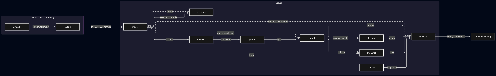

# blade

Server side of a drone ISR system built on Arma 3. An Arma PC plays the drone: it sends one MPEG-TS
stream (H.264 + one telemetry packet per frame). The server detects objects in the video, places them
on the map, fuses them into one world picture and raises attention cues for the operator.

Services talk over NATS, keyed by `(stream_id, frame)`. REST is only for control.



## Services

Each service has its own README with its API.

| Service | Port | What it does |
|---|---|---|
| [uplink](services/uplink/README.md) | (Arma PC) | Captures the game screen, pairs each frame with telemetry, sends MPEG-TS |
| [ingest](services/ingest/README.md) | 8001, 9000, 9100/udp | Receives video and sim truth, publishes decoded frames |
| [sessions](services/sessions/README.md) | 8002 | Records streams, imports recordings, replays them |
| [detector](services/detector/README.md) | 8003 | YOLO (ONNX Runtime) + BoT-SORT tracking per stream |
| [georef](services/georef/README.md) | 8004 | Projects each box onto the terrain |
| [world](services/world/README.md) | 8005 | Fuses per-stream tracks into map objects |
| [terrain](services/terrain/README.md) | 8006 | Serves map packages: metadata, heights, image crops |
| [evaluator](services/evaluator/README.md) | 8007 | Measures position error against sim truth |
| [decision](services/decision/README.md) | 8008 | Rules that raise alerts for the operator |
| [gateway](services/gateway/README.md) | 8000 | The one entry point for clients: sessions, `/api` proxy, WebSocket |

## Bus subjects

Every message is one envelope (`v`, `sid`, `frame`, `wid`, `ts`, `data`). Payload schemas are in
`contracts/`, generated from `libs/common/blade_common/contracts.py`.

| Subject | From | Payload |
|---|---|---|
| `frames.<sid>` | ingest | telemetry + JPEG |
| `truth.<sid>`, `registry.<sid>`, `events.<sid>` | ingest | sim truth from the game |
| `raw.<sid>` | ingest | live MPEG-TS bytes, for recording |
| `detections.<sid>` | detector | boxes with class, track id, confidence |
| `geo.<sid>` | georef | map position and σ per box, camera footprint |
| `world.<wid>.objects`, `world.<wid>.events` | world | fused objects, events (explosions) |
| `alerts.<wid>` | decision | active alerts |
| `eval.<wid>` | evaluator | CEP and detection rate |
| `ack.<sid>` | world | frame done (replays with `delivery: all`) |
| `diag.<service>` | all | per-stream fps, latency, drops |

`sid` is a stream (one drone), `wid` is a world (streams in the same world are fused together).

## Frontend

[frontend](frontend/README.md) is a React + TypeScript app (Vite) that talks only to the gateway: REST for control, the
WebSocket for live data. In dev, Vite forwards `/api`, `/sessions`, `/detectors`, `/streams` and `/ws` to
the gateway on `127.0.0.1:8000` (`GATEWAY_URL` for another machine). It has the session picker, the drones'
video with boxes and the map. How to draw object motion (arrows, prediction cones): `services/world/README.md`.

## Run

Needs a map package in `maps/<map name>` and, for replays, a recording in `recordings/`.

```bash
uv sync
```
```bash
brew install nats-server
```
```bash
uv run python tools/dev.py --model oracle
```

`tools/dev.py` starts NATS and every service in one terminal. `--model oracle` makes boxes from the
recording's sim truth; for the real model, copy `best.onnx` to `models/arma_detector_v1/model.onnx` and
leave out `--model`.

Watch in the browser (Node.js 22+): start the frontend, open http://localhost:5173 and pick a recording to replay
or a live stream:
```bash
cd frontend && npm install && npm run dev
```

On the Arma PC (Windows), see [uplink](services/uplink/README.md):
```bash
uv run blade-uplink --sid pc1-uav1 --server <server-ip>
```

With Docker:
```bash
docker compose -f deploy/compose.yaml up --build
```

Tests:
```bash
uv run pytest
```

## Map package

Export map with grad_meh in the game, then build `maps/<map name>` (`dem.tif`, `meta.json`, `ortho/`). `<map name>` is
Arma's `worldName` in lower case (`altis`, `stratis`): the `map` the mission sends in its telemetry picks the package.
```bash
uv run python terrain/build_dem.py "<Arma 3>/grad_meh/<map name>" --out maps/<map name>
```
```bash
uv run python terrain/build_ortho.py "<Arma 3>/grad_meh/<map name>" --out maps/<map name>
```

## Repository

```
contracts/   JSON Schema per bus subject (generated)
libs/        common (envelope, NATS helpers, KLV), geometry (camera, terrain, sigma), frame_code, enhance
services/    one folder per service, each with a README
frontend/    operator web app (React + TypeScript, Vite); not part of the uv workspace
tools/       dev.py, busmon.py, eval_report.py, pixel_error.py, world_score.py
models/      model packages (model.yaml, tracker.yaml; model.onnx is not in git)
terrain/     map package builders
deploy/      Dockerfile, compose.yaml, compose.gpu.yaml, nats.conf
docs/        architecture.mmd (Mermaid source) and the rendered architecture.png
tests/
```
